# 职航智管求职训练与职业成长服务系统 作品介绍详细版

版本 V1.0  编制日期 2026-10-25  修订完成 2026-10-26

本文件与详细版Word、PDF使用同一内容源。历史实测与本次核对分别标注；文中的评估、治理和路线内容如尚未落实，均按建议说明。

## 导读

- 01 项目概览与评审导读
- 02 项目背景与需求分析
- 03 用户角色与端到端场景
- 04 总体技术架构与职责划分
- 05 主智能体与专业智能体协同
- 06 工具授权与人工确认机制
- 07 会话持久化与异步运行状态
- 08 数据模型与证据链
- 09 画像确认与四周行动计划
- 10 岗位分析与简历版本
- 11 模拟面试与可选多模态训练
- 12 学习任务与入职后工作交付
- 13 申请状态与每周复盘
- 14 班级风险与帮扶验收
- 15 入职回访与就业质量反馈
- 16 部署模式与复现路径
- 17 验证结果与证据范围
- 18 已知问题与风险处置
- 19 开源现状与依赖许可
- 20 贡献流程与版本发布方案
- 21 长期发展路线与交付责任
- 22 试点评估与验收设计
- 23 现场演示脚本与异常预案
- 24 提交清单与证据索引

## 01 项目概览与评审导读

职航智管是一套通过浏览器访问的求职训练与职业成长服务系统，服务对象包括高校毕业生、就业辅导员和负责质量管理的工作人员。系统将材料整理、目标确认、计划执行、岗位准备、面试训练、投递复盘和入职回访串联起来，使每次建议能够关联业务记录，每个需要落实的行动能够找到责任人和结果。

比赛截图要求提交可运行的代码仓库、作品介绍文档和演示视频链接。作品介绍至少需要说明项目背景、技术架构、应用场景与创新点；评审由技术创新、场景落地、开源治理和长期发展四部分组成。本详细版同时展示实现方式、验证证据和仍需补齐的条件。

| 维度 | 重点回答 | 本稿主要章节 |
| --- | --- | --- |
| 技术创新 30% | 语言理解如何连接受控的业务执行 | 04—08 架构、编排、授权、状态与数据 |
| 场景落地 30% | 谁在何种场景中完成哪些任务 | 09—15 学生训练、辅导员帮扶与回访 |
| 开源治理 20% | 代码如何被复现、审查和继续维护 | 16、19、20 部署、许可、贡献与发布 |
| 长期发展 20% | 试点、运营和持续改进如何推进 | 18、21、22 风险、计划和验收指标 |

### 项目状态的四种口径

“源码实现”表示已找到相应模块或配置；“历史实测”指2026-10-20及2026-10-22保存的测试和浏览器证据；“本次核对”指2026-10-25的源码与文档检查；“后续计划”表示尚未落地的治理或运营工作。四者不能互相替代。

截至本次核对，服务器演示首页与/api/health均返回HTTP 200；这只证明基础入口可达，不证明评审账号、在线模型或全部流程均正常。公开代码仓库和视频链接仍待补充。

实现或证据依据：`比赛要求截图`；`README.md`；`frontend/src/app/router.tsx`

## 02 项目背景与需求分析

毕业生求职通常跨越多份材料、多条岗位和多个阶段。画像、简历、投递、笔试、面试、学习任务各自更新时，指导者很难快速还原学生当前最需要解决的问题。通用对话助手能提供建议，但如果没有资源上下文、明确的执行范围和结果记录，下一次对话仍可能从头开始。

职航智管将需求具体化为三个问题：学生下一步做什么，辅导员为什么需要跟进，以及后续训练是否回应了前一轮的差距。项目没有开展可量化的全国用户调研，因此不使用“多数学生”“效率提升百分比”等缺少样本支持的结论。以下需求来自项目建模的就业指导业务过程。

| 角色 | 业务问题 | 对应设计 |
| --- | --- | --- |
| 学生 | 材料散落，目标和准备动作缺少关联 | 确认画像，保留证据，按周组织任务 |
| 辅导员 | 需要从进展信息定位值得跟进的学生 | 读取班级范围内的记录，解释风险触发事实 |
| 就业管理 | 需要知道帮扶发生了什么以及是否完成 | 学生反馈、人工验收、质量汇总和审计记录 |
| 入职后学习者 | 会回答问题不代表会完成工作任务 | 单独设置工作简报、交付物、评审和复盘 |

### 设计目标与范围

近期目标是形成可运行、可解释的业务原型，降低跨页面整理上下文和重复记录的成本；中期目标是在授权试点中验证任务质量与服务稳定性。实际就业率、录用率或训练收益需要长期样本与人工复核，不能由演示分数推断。

系统不代替学生向外部招聘网站投递，不把风险规则当作学生能力结论，也不把工作训练中的虚构情景描述当作真实任职经历。公开岗位采集和模型接口均受到来源时效、网络与服务状态限制。

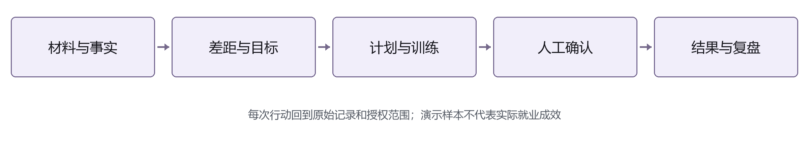

实现或证据依据：`README.md`；`docs/workplace-workbench.md`；`backend/app/dashboard/router.py`

## 03 用户角色与端到端场景

学生端、辅导员端和企业评价入口使用不同的访问方式。前端按角色展示导航，服务端再校验接口权限和资源归属；页面不可见本身不构成访问控制。角色为admin的账号仅在实现允许的管理接口中使用，不能据此推定系统已经具备完整的多租户管理能力。

| 对象 | 主要工作区 | 访问边界 |
| --- | --- | --- |
| 学生 | 画像、计划、学习、岗位、面试、投递、入职跟踪 | 处理本人记录；模型不能扩大范围 |
| 辅导员 | 班级概览、学生进展、帮扶、质量、运行统计 | 按班级与学生归属规则读取授权对象 |
| 系统管理角色 | 被接口允许的治理、配置与统计 | 依赖具体接口权限，不默认公开全部数据 |
| 企业评价填写者 | 一次性邀请页面 | 仅填写对应邀请，不能浏览学生工作台 |

### 示例场景

演示学生A的目标岗位为数据分析师。画像显示Python与SQL基础，但项目结果需要补充可核实证据。学生先查看四周计划和岗位匹配，再进行一次模拟面试；如果任务或申请长时间没有推进，辅导员可读取触发事实，创建具体任务，由学生反馈、辅导员验收。进入录用阶段后，学生可建立就业记录，参与入职回访。

上述路径跨越学生、辅导员与企业反馈，但各环节均需独立的事实和授权：生成计划不等于任务完成，提交反馈不等于验收通过，申请标记录用也不等于已经入职。系统通过单独的记录和状态表达这些区别。

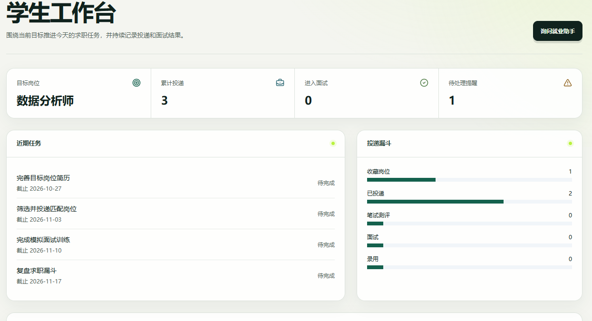

实现或证据依据：`frontend/src/app/router.tsx`；`backend/app/auth/models.py`；`backend/app/students/service.py`

## 04 总体技术架构与职责划分

系统采用前后端分离结构。React与TypeScript负责页面和交互，FastAPI负责身份校验、业务接口与事务，SQLAlchemy负责数据访问。Agent网关通过结构化契约连接模型供应商或本地规则实现。模型服务是可替换组件，业务事实和权限仍由后端维护。

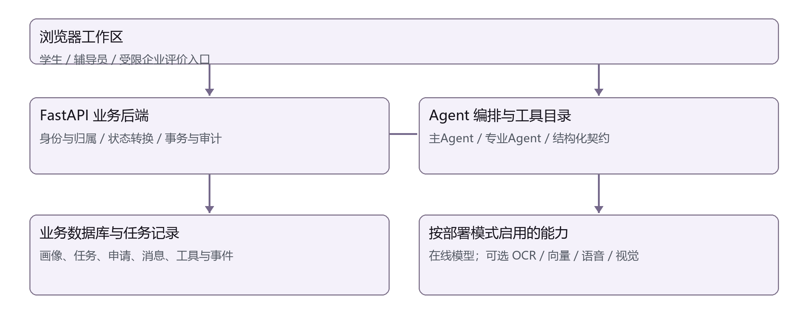

| 层次 | 主要组件 | 明确职责 |
| --- | --- | --- |
| 交互层 | React、Router、React Query、ECharts | 页面导航、请求状态、会话事件与结果展示 |
| 业务层 | FastAPI、Pydantic、JWT/RBAC | 资源归属、参数契约、状态变更与错误返回 |
| 编排层 | 主Agent、专业Agent、工具注册表 | 拆任务、获取证据、汇总结论或动作提案 |
| 数据层 | SQLAlchemy、SQLite或PostgreSQL | 业务事实、消息、步骤、工具及事件记录 |
| 可选服务层 | Embedding、OCR、ASR/TTS、Emotion | 按部署模式和服务就绪状态提供能力 |

本地演示使用SQLite，部署配置支持PostgreSQL和pgvector；两者不是同一种性能验证环境。Worker从任务表领取任务并处理耗时工作，Redis用于部署中的辅助能力。全量服务拓扑与低资源服务器演示版分别说明，不能把配置文件存在等同于所有模型容器已启动。

实现或证据依据：`backend/app/main.py`；`frontend/package.json`；`backend/pyproject.toml`；`docker-compose.yml`

## 05 主智能体与专业智能体协同

一个包含职业规划和投递管理的问题，往往需要同时读取画像、目标、任务与申请记录。主智能体先将问题转成结构化计划，再组织专业智能体处理相应任务，最终汇总为回答。计划中的步骤有唯一标识与依赖关系，契约会拒绝重复步骤和引用尚未出现步骤的依赖。

| 专业领域 | 职责示例 | 依赖的业务事实 |
| --- | --- | --- |
| career / job / resume | 规划方向、岗位比较、简历建议 | 画像、计划、岗位和简历 |
| application / interview | 申请进展、面试准备和复盘 | 阶段事件、面试回答与评分 |
| counselor / learning | 帮扶线索、学习任务与测验 | 班级范围、风险、课程与结果 |
| workplace / intelligence / employment | 工作交付、岗位来源、入职反馈 | 情景简报、采集状态、就业记录 |

### 一次可复核的运行

2026-10-20保存的本地回放使用问题“请结合我的就业画像、求职计划和最近投递记录，告诉我本周最优先的三项行动，并说明依据”。career步骤读取profile.get、plan.get和tasks.list；application步骤读取applications.list。2个专业步骤、4个只读调用均完成，provider为local-rules。

这次回放证明了从真实业务记录读取、工具记录保存到回答持久化的流程。它没有调用在线大模型，因此不能用该次耗时或输出评价在线模型推理能力。专业领域数量表示契约支持的10类名称，不等于每个领域都经过了同样深度的独立测评。

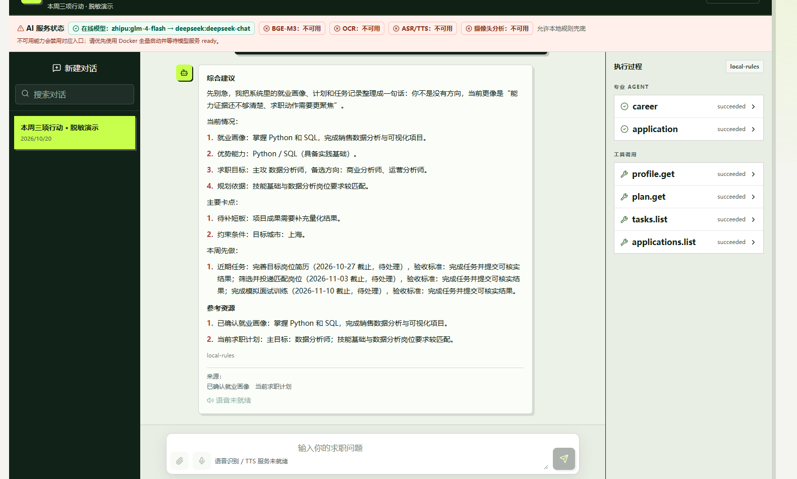

实现或证据依据：`backend/app/agents/conversation_contracts.py`；`backend/app/chat/orchestrator.py`；`backend/app/agents/service.py`

## 06 工具授权与人工确认机制

专业智能体请求工具后，系统重新检查执行身份、学生归属、专业领域、参数和返回结构。目录过滤只能减少模型可选项，实际执行仍需服务端校验。工具的风险级别来自注册定义，不接受模型通过参数自行降低风险。

| 检查阶段 | 实现行为 | 失败结果 |
| --- | --- | --- |
| 身份与归属 | 核对用户有效、角色一致、学生归属允许 | 拒绝越权请求，不读取其他学生数据 |
| 工具与领域 | 只解析已注册名称，检查专业领域 | 拒绝未知工具或领域不匹配 |
| 输入输出契约 | Pydantic校验参数与返回结构 | 返回错误码，避免把异常结构当业务结论 |
| 写操作确认 | confirm模式先生成提案；auto仍检查风险 | 高风险入口不会因自动模式变为可执行 |
| 执行与撤销 | 记录状态、结果、操作者；可逆工具带撤销数据 | 不支持撤销的工具返回明确错误 |

历史目录盘点为32个定义：20个只读、9个普通写、3个高风险入口。3个高风险入口绑定拒绝处理器，表示明确禁止的动作边界，不表示已实现删除、批量修改或外部代投。普通写动作的确认也不意味着可修改任意资源。

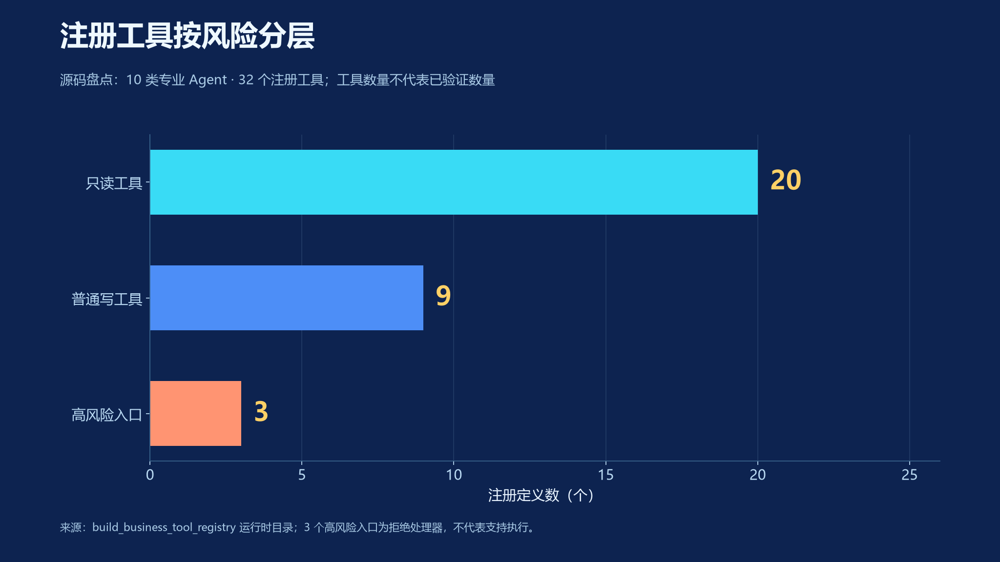

写动作使用幂等键识别重复请求，成功后关联业务结果与审计记录；失败保留错误状态。撤销只适用于声明可逆且存在撤销处理器的工具，并再次校验操作者权限。评审时可从只读调用、待确认提案和拒绝入口三个例子检查边界。

实现或证据依据：`backend/app/tools/registry.py`；`backend/app/tools/authorization.py`；`backend/app/chat/actions.py`

## 07 会话持久化与异步运行状态

会话不仅保存文字，还关联用户消息、运行实例、专业步骤、工具调用和动作提案。发送消息时需提供Idempotency-Key：同一会话重复提交相同键会返回已接受的运行，而不是创建新的业务动作。数据库还约束一个会话同时只有一个queued或running运行。

```text
POST /api/chat/sessions/{session_id}/messages
Idempotency-Key: 由客户端为本次发送生成的唯一值
返回：message_id、run_id、events_url、status=queued
```

消息接受后，后端创建AI任务并保存run.queued事件；Worker处理后推进步骤和工具状态。浏览器通过SSE按事件序号读取事件，并用after游标继续拉取；运行详情接口用于回看结论、参数、错误与耗时。任务状态和页面流式文字是两种信息，页面中断不应直接推断任务已失败。

| 记录 | 关键字段或约束 | 用途 |
| --- | --- | --- |
| ChatSession / ChatMessage | owner、mode、status；session+request_key唯一 | 恢复会话并避免重复消息 |
| AgentRun / AgentStep | status、provider、plan、依赖、时间 | 解释运行是否完成、在哪一步结束 |
| ToolCall / ActionProposal | 工具版本、风险、幂等键、确认状态 | 保存候选动作与实际执行区别 |
| 运行事件 | 单调序号、事件类型和载荷 | 流式显示、断线后按序继续读取 |

### 恢复与失败处理的实际边界

历史浏览器检查中，刷新前后同一问题的用户消息均为2条，未重复或丢失；这项检查只覆盖消息恢复。历史执行面板刷新后没有自动还原至先前展开的工具详情，不能在材料中声称整个面板恢复已通过。超时、租约和失败重试机制也需要在目标部署环境继续验证。

实现或证据依据：`backend/app/chat/router.py`；`backend/app/chat/models.py`；`backend/app/chat/events.py`；`backend/app/ai/service.py`

## 08 数据模型与证据链

数据组织以业务对象和状态为中心。画像与简历记录提供个人事实；岗位和来源记录提供需求事实；计划、任务、申请事件与训练结果提供过程事实；会话和审计记录说明建议及动作如何产生。向量检索是获取片段的方法，不能替代资源权限和事实确认。

| 对象组 | 关系与字段 | 防止的误读 |
| --- | --- | --- |
| 画像与简历 | 学生归属、版本、解析状态、原文 | 草稿不等于确认经历，解析失败不等于上传失败 |
| 岗位与来源 | 岗位描述、URL、主机、时间、状态 | 演示岗位不等于当前公开招聘 |
| 计划与任务 | 目标、周次、截止日期、状态、验收要求 | 计划已生成不等于任务已完成 |
| 申请与事件 | 当前阶段、from/to、发生时间 | 当前分布不等于累计漏斗 |
| 面试与交付 | 回答、评价、量表、revision、场次报告 | 单轮分不等于均分，草案不等于交付 |
| 运行与审计 | 会话、运行、工具、确认者、结果 | 模型建议不等于已执行的业务事实 |

知识片段的设计包括内容、来源、时间、适用范围和资源归属。源码中向量字段配置为1024维；服务器演示版未部署BGE-M3服务，不能用“数据库包含向量字段”声称已经完成语义检索。检索没有结果时，应提示缺少可引用材料。

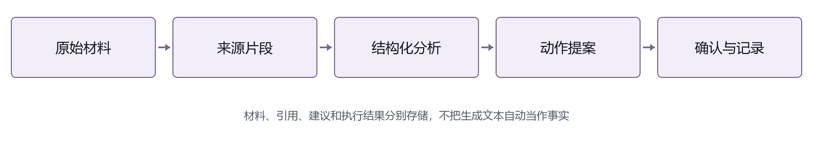

入职评价与个人资料分开处理，按审核状态和样本阈值决定是否显示汇总。默认企业画像要求至少3条审核通过样本，这只是当前源码阈值，并不能替代上线时对小样本识别风险的评估。

实现或证据依据：`backend/app/core/models.py`；`backend/app/chat/models.py`；`backend/app/applications/models.py`；`backend/app/ai/models.py`

## 09 画像确认与四周行动计划

学生可以直接提供简历文本和求职偏好，先查看画像草稿中的能力、证据、差距与约束，再决定是否确认。此流程避免把模型推断自动写成个人事实。计划生成依赖已确认画像和目标方向，输出主目标、备选岗位以及包含截止日期和验收标准的分周任务。

### 输入、操作和可验收结果

| 环节 | 输入或操作 | 应看到的结果 |
| --- | --- | --- |
| 画像草稿 | 本人经历、技能、目标城市与行业 | 可核对的结论和原文证据 |
| 画像确认 | 学生检查草稿并主动确认 | 正式画像版本发生变化 |
| 四周计划 | 画像摘要、目标岗位 | 主目标、备选方向和按周任务 |
| 任务推进 | 按任务要求准备材料或训练 | 记录可回看的完成事实 |

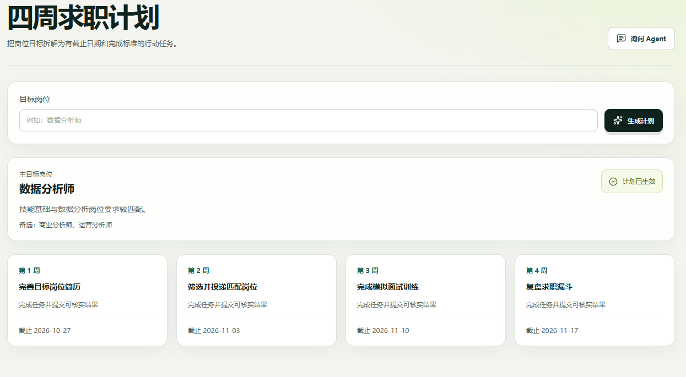

以数据分析师场景为例，学生画像显示Python和SQL基础，但量化结果证据不足。计划可先安排补充简历证据，再筛选岗位、完成面试训练和复盘。相同模板并不保证适合所有专业；试点应由辅导员抽检任务是否明确、可完成、能被核验。

画像与计划是两个独立确认环节。若材料无法解析，应先补充可读文本，不得将失败状态隐藏为“已分析”。本项目在2026-10-22的实际DOCX上传中出现解析失败，详细限制在测试与风险章节保留。

实现或证据依据：`backend/app/students/router.py`；`backend/app/students/service.py`；`backend/app/plans/router.py`；`frontend/src/features/student/PlanPage.tsx`

## 10 岗位分析与简历版本

岗位匹配将“是否适合”拆成硬性条件、技能、经历、偏好与发展方向五个维度。每个维度同时展示分数与输入依据，学生再决定补充材料或开展训练。公开来源另外保存采集状态与新鲜度；用户需要返回原页面核实职位仍然有效。

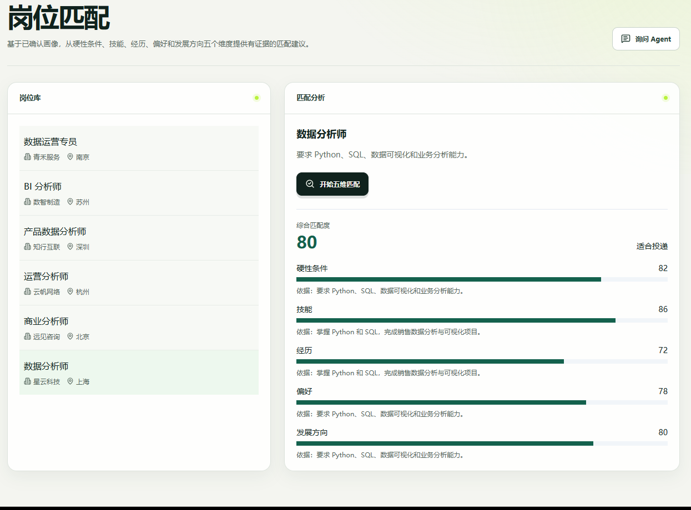

历史演示返回82、86、72、78、80五个维度分，综合80/100。数值来自本地规则适配器的预设结果，不能表达为80%准确率、录用率或模型效果。在正式评估中，需要使用获得授权的简历与岗位样本，保存人工比较结果并说明样本量。

### 简历建议的保存边界

后端支持基于本人简历与目标岗位产生修改草稿，再确认形成版本；接口保存原文、建议与理由。当前页面主要展示文件列表、解析状态和“询问Agent”上下文入口，不能把后端存在确认接口写成已经完成独立的可视化编辑器。任何量化成果、公司名称与责任范围均需由学生本人核实。

2026-10-20独立演示库中公共岗位和启用来源均为0，6条岗位属于演示数据。后续新增公开来源配置不应与该历史样本混算。抓取失败、字段缺失或内容过期是来源侧的真实状态，不能用自动补写文本掩盖。

实现或证据依据：`backend/app/jobs/router.py`；`backend/app/agents/local.py`；`backend/app/resumes/router.py`；`backend/app/intelligence/service.py`

## 11 模拟面试与可选多模态训练

模拟面试把岗位要求、简历原文与回答关联到场次。默认结构包括6个核心问题、最多2个追问；数据库配置的情景可以改变题目结构。前端按开始、增量、评价与完成事件更新显示，后端保留回答、逐轮评价、追问及场次报告。

| 评分维度 | 检查内容 | 用户改进方向 |
| --- | --- | --- |
| 内容完整度 | 是否说明背景、任务、行动和结果 | 补齐缺失的业务要素 |
| 岗位相关性 | 回答是否回应岗位要求 | 选择与职责相关的本人经历 |
| 表达结构 | 顺序和重点是否清楚 | 先结论再依据，明确本人贡献 |
| 证据质量 | 是否有可核实方法和结果 | 区分观察事实与未经验证的推测 |

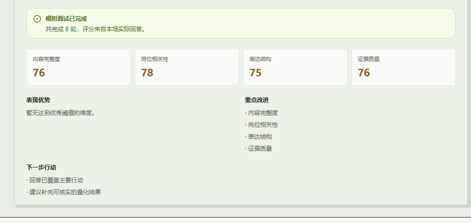

上图使用unified-v1场次均分；单轮面板可能显示不同分数。结果来自local-demo，不代表人类评分一致性、训练前后提升或录用判断。量表质量需要采用人工标注样本、多轮对比和版本记录进一步校准。

全量服务设计支持语音输入、问题朗读和可选摄像头采样。摄像头约每秒发送一帧，最多保留20条统计记录，不保存原始视频或图像；无清晰人脸时不计分。服务器演示版未部署这些本地模型，因此只能展示文字问题和文字回答，不能生成假的表情分析结果。

实现或证据依据：`backend/app/interviews/router.py`；`backend/app/interviews/service.py`；`services/emotion/app.py`；`frontend/src/features/student/interview-api.ts`

## 12 学习任务与入职后工作交付

学习成长模块将能力差距关联课程、任务和测验；任务可以记录完成说明与证据。测验保存作答、评分与复习记录，为后续训练提供上下文。能力维度或数据量不足时，界面应显示不足提示，不画没有依据的成长曲线。

职场训练另行处理入职后任务，不复用面试回答来冒充工作结果。情景简报包含角色、阶段、目标、协作对象、交付物、期限、验收标准和约束。学生可以保存草案、提交交付物，并查看结构化评审和版本历史。至少提交一份交付物后，才允许完成会话复盘。

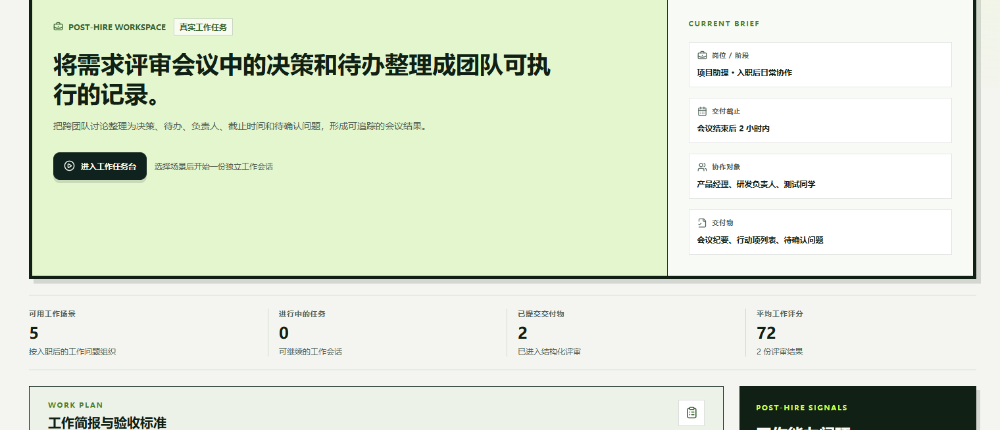

| 功能 | 形成的记录 | 当前验证程度 |
| --- | --- | --- |
| 课程与学习任务 | 状态、完成说明、证据链接 | 页面与接口实现，仍需内容质量复核 |
| 测验与复习 | 试卷、答案、提交结果、错题 | 代码已实现，非所有题型均完成实调 |
| 职场交付 | revision、评审、复盘报告 | 历史桌面E2E通过1条交付流程 |

5个职场情景是配置数量，不代表5个场景都经过验证。AI生成的内容只作为草案，学生需核对任务事实后提交；不得向外部业务系统自动提交，也不得将演示情景写入本人真实工作履历。

实现或证据依据：`backend/app/growth/service.py`；`backend/app/workplace/service.py`；`docs/workplace-workbench.md`

## 13 申请状态与每周复盘

申请记录保存岗位、学生及当前阶段，阶段变化另外形成事件。服务端按状态转换规则处理请求，而不是允许页面任意写入状态。收藏可以变为已投递或关闭；已投递可到笔试、面试或关闭；笔试可到面试或关闭；面试可到录用或关闭；录用可关闭。关闭状态不再继续流转。

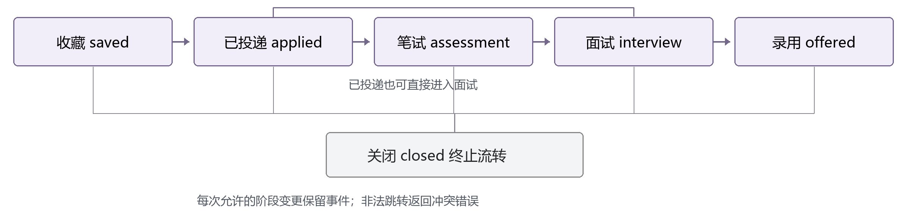

| 阶段 | 当前记录数 | 曾到达该阶段的申请数 |
| --- | --- | --- |
| 收藏 / 入库 | 17 | 85 |
| 已投递 | 18 | 68 |
| 笔试 | 17 | 50 |
| 面试 | 17 | 33 |
| 录用 | 16 | 16 |

表内全部是人工构造演示记录。当前列互斥、合计85；累计列按申请ID去重，同一记录可计入多个阶段。85条记录包含收藏，不能写成85次实际投递；16条录用状态也不代表16名真实用户获得录用。

每周复盘读取最近七天的阶段事件，计算投递、笔试、面试和录用等指标，再给出最多三项优先动作。它与全量当前状态分布具有不同时间窗口和分母。评审演示应说明这一差别，避免将看板、复盘和历史累计数直接比较为效果提升。

实现或证据依据：`backend/app/applications/service.py`；`backend/app/applications/models.py`；`backend/app/reviews/router.py`

## 14 班级风险与帮扶验收

辅导员在授权班级范围内查看学生进展与风险事实，决定是否进一步沟通或布置任务。规则返回触发原因、数值和级别，便于人工核对；风险不作为录用预测，不自动对学生排名、处分或限制服务。

| 规则 | 阈值 | 级别 |
| --- | --- | --- |
| 建档后未确认目标 | ≥7天 | 关注 |
| 连续无投递 | ≥14天 | 需干预 |
| 计划任务逾期 | ≥3项 | 关注 |
| 申请达到阈值但未进入面试 | ≥20条 | 需干预 |
| 连续面试未通过 | ≥3次 | 需干预 |

规则函数具有5类判断，但当前调度代码将连续面试未通过数固定为0，申请未面试规则也需进一步核对收藏是否计入分母。因此，15个函数阈值用例通过，只证明规则函数按输入触发，不证明5类事实都已自动采集并持续运行。服务器演示配置还关闭了定时扫描。

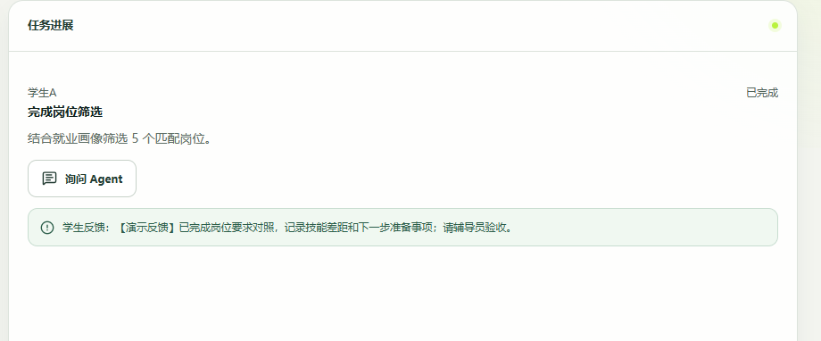

帮扶接口状态为assigned→submitted→resolved：学生提交反馈时核对本人归属和当前状态；辅导员确认完成时核对学生范围并要求已提交。历史浏览器完成过此链路，记录保留真实反馈和验收结果。按当前源码，该接口没有显示独立的截止日期字段，材料不把计划任务字段套用到帮扶任务。

风险事件数与风险学生数要分开。历史24人演示样本中每人仅一条风险事件，9条恰好对应9人；真实班级可能一人多条，汇总需按学生去重，避免驾驶舱图形因直接相减而出现误解。

实现或证据依据：`backend/app/risks/rules.py`；`backend/app/core/scheduler.py`；`backend/app/interventions/router.py`

## 15 入职回访与就业质量反馈

学生只有在申请进入录用阶段后，才能将相应记录关联为就业记录，补充入职日期和是否授权企业评价。系统组织7、30、90、180天回访，将学生主观反馈、企业评价和面试经验分开保存；它们不是一份可以直接互相替代的评分。

| 数据 | 内容示例 | 使用限制 |
| --- | --- | --- |
| 学生反馈 | 岗位一致性、带教、工作强度、成长空间 | 基于本人体验，不公开个人原始材料 |
| 企业评价 | 适岗、专业技能、沟通协作、任务质量 | 通过对应邀请提交，禁止复用邀请 |
| 面试经验 | 流程、题目、建议与待改进事项 | 审核后提供参考，避免泄露第三方隐私 |
| 企业画像汇总 | 审核通过样本的维度均分与建议 | 达到默认3条阈值后才显示相关汇总 |

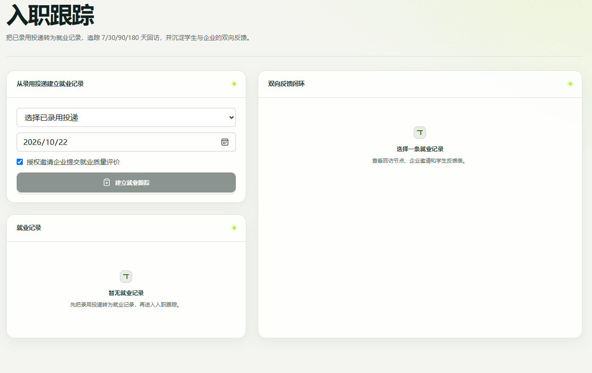

邀请使用一次性令牌，令牌只用于对应记录，不应在公开截图或仓库中出现。企业画像通过审核状态与最小样本阈值减少小样本披露，但默认阈值不代表已完成正式隐私评估；上线前还需要确认访问范围、删除流程和反馈用途。

本次只核对代码和已有页面，没有新增真实企业回访样本，也没有用构造评分推断培养效果。课程改进属于长期用途，应在授权试点中说明数据如何汇总、由谁复核、是否允许纠正或撤回。

实现或证据依据：`backend/app/employment/router.py`；`backend/app/employment/service.py`；`frontend/src/features/public/EmployerReviewPage.tsx`

## 16 部署模式与复现路径

项目提供全量本地与低资源服务器演示两种部署思路。全量版包含模型服务配置；服务器演示版保留业务数据库与轻量Worker，调用外部模型API，主动禁用未部署的OCR、向量、语音、视觉及对话附件任务。

| 能力 | 全量本地配置 | server-demo |
| --- | --- | --- |
| 业务页面与数据库 | 本地SQLite或部署PostgreSQL | PostgreSQL、Redis、API、Nginx |
| Agent | 在线适配器或local演示按配置选择 | 在线API；失败时不回退本地规则 |
| OCR / BGE-M3 | 满足资源并启动服务后可启用 | 未部署；后端拒绝相应任务 |
| 语音 / 摄像头 | 服务与授权同时满足才可用 | 未部署，页面禁用相关入口 |
| 对话附件 | 解析与向量服务就绪才开放 | 入口与任务均限制 |

### 服务器演示版启动方式

```text
docker compose --env-file .env.server-demo -f docker-compose.server-demo.yml up -d --build
docker compose --env-file .env.server-demo -f docker-compose.server-demo.yml ps
```

启动前按照环境模板填写随机密钥、数据库密码、加密密钥、专用演示密码和可用模型API；前端以server-demo模式构建。对已有数据库不要运行down -v，以免删除卷。正式公开使用前需要域名、TLS、备份恢复及资源监控。

2026-10-25只读检查http://111.228.30.194/与/api/health均返回200，健康体为status=ok。没有进行账号登录、在线模型调用、压力测试或数据写入；该地址仍需项目方确认用于正式评审。仓库URL与视频URL继续留空。

本地开发应显式将VITE_API_PROXY_TARGET指向实际API端口；当前Vite默认代理为8080，不能照搬旧README中8000的描述而不检查。复现说明应同时写出浏览器入口、API端口、部署模式和使用的Provider。

实现或证据依据：`docs/server-demo-deployment.md`；`docker-compose.server-demo.yml`；`frontend/vite.config.ts`；`README.md`

## 17 验证结果与证据范围

本章引用已保存的历史证据。2026-10-25主要进行源码核对和文档渲染，没有把旧日志重新命名为今日测试，也没有再次运行全部后端、前端和E2E测试。以下结果可用于了解此前版本的验证范围，正式提交版本仍需复测并记录时间与环境。

| 验证时间 | 项目 | 结果与边界 |
| --- | --- | --- |
| 2026-10-20 | 后端与前端组件 | 后端63/63、组件25/25；不是业务准确率 |
| 2026-10-20 | 本地API与规则 | 22/22流程用例，15/15阈值用例 |
| 2026-10-20 | 现有浏览器串行回归 | 1/6通过；5项未通过保留 |
| 2026-10-20 | 补充浏览器与样本一致性 | 14项操作检查；24/24构造学生规则对齐 |
| 2026-10-22 | 真实DOCX上传 | HTTP201保存文件，解析状态失败 |
| 2026-10-25 | 服务器基础连通 | 首页及健康接口200；未检查登录与模型 |

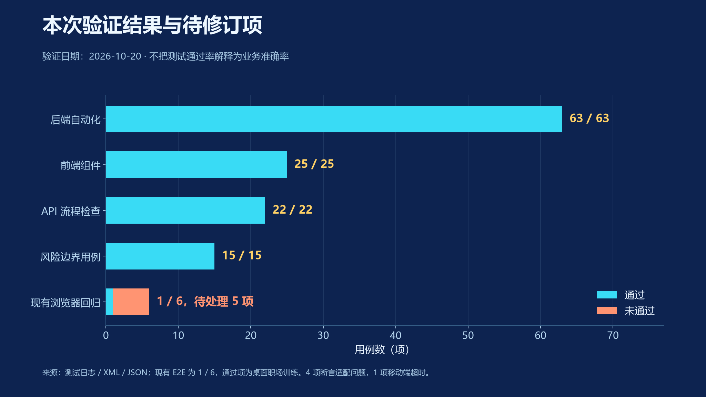

浏览器未通过项包括：风险文案出现多条导致唯一定位失败2项；UI“技能”与旧断言“技能匹配”不一致2项；移动端职场流程超时1项。补充浏览器脚本完成的流程不能覆盖或删除这些失败。测试集内缺少目标场景的用例时，已有测试通过也不能推定该场景正常。

本地读取接口还记录过5个接口各20次顺序GET，全部200；这不是并发压测，也不含在线模型、OCR、语音或视觉耗时。本稿不采用这些延迟作为生产性能承诺。

实现或证据依据：`output/ppt-evidence-2026-10-20/backend-tests-current.xml`；`output/ppt-evidence-2026-10-20/data_summary.json`；`output/copyright-20261022/capture.log`

## 18 已知问题与风险处置

项目目前具有可运行原型和部分实测证据，也存在应在参赛提交或试点前处理的问题。以下为代码与历史记录能支持的具体缺口，避免只写“持续优化稳定性”而没有触发条件、影响和验收方式。本次整理文档没有修改这些功能代码。

| 问题或触发 | 影响 | 建议处置与验收 |
| --- | --- | --- |
| DOCX上传保存后解析失败 | 材料存在，但后续分析缺少原文 | 核对路径类型与解析器参数；用真实文件复测成功/失败分支 |
| 规则函数与定时事实未完全对齐 | 函数测试通过不代表所有风险自动更新 | 补齐面试失败事实与申请统计分母；验证扫描与界面一致 |
| 风险事件与风险人数混算 | 一人多条时图形或人数可能误导 | 按学生聚合后展示，并加一人多风险测试 |
| 历史执行面板刷新不自动恢复 | 消息存在但详情面板需要重新进入 | 复原run关联状态；检查消息与详情恢复的不同用例 |
| 浏览器回归仍有5项失败 | 缺少完整提交版本端到端通过证据 | 修订选择器与文案，定位移动超时后复跑 |

上传路径的一个静态线索是save_upload返回存储引用字符串，而parse_resume按Path调用suffix，接口会捕获异常并标记failed。该线索与2026-10-22的实际失败相符，但仍需通过修复后的真实文件回归确认；不能只在说明书把状态改成“成功”。

### 上线前的风险处置原则

个人材料应限制访问与日志内容；模型建议保留来源和确认；公开岗位显示时效；服务器接入TLS并隔离真实凭据；数据删除、模型调用成本和异步失败需要可操作的处理流程。摄像头模块只作训练参考，不能扩大为心理诊断或录用评价。

实现或证据依据：`backend/app/resumes/router.py`；`backend/app/resumes/parser.py`；`backend/app/core/scheduler.py`；`frontend/src/features/counselor/CounselorDashboard.tsx`

## 19 开源现状与依赖许可

当前仓库没有配置公开Git remote，项目根目录也没有找到LICENSE、NOTICE、CONTRIBUTING、SECURITY或公开协作模板。代码在本地可查看，不等于已经完成开源发布。比赛开源治理20%的要求，需要项目方落实仓库访问、许可选择和依赖说明，文档本身不能代替这些工作。

| 对象 | 当前证据 | 发布前需要确认 |
| --- | --- | --- |
| 项目业务源码 | 存在前后端、服务与迁移目录 | 权利主体与对外授权范围；选择实际许可证 |
| 框架与运行依赖 | package.json、pyproject、requirements | 固定评审版本，汇总许可证与必要声明 |
| 模型及语音/视觉模块 | 模型服务代码与下载配置 | 权重、代码和模型数据的许可分别核对 |
| 数字人头像 | 已有Unsplash来源说明文件 | 保留来源，核查实际素材使用条件 |
| 第三方改编代码 | MeloTTS相关辅助文件 | 说明修改来源并履行对应分发义务 |

### 建议的发布材料

在发布清单中建立“组件—版本—用途—来源—许可—分发方式—维护人”字段。PyMuPDF、Ultralytics及模型权重等组件应重点核对实际版本的授权条件；不能因为框架常见，就统一写成所有依赖均可任意商用。尚未完成核查时，应如实保留待确认状态。

本次不擅自替项目选定许可证，不生成带未经确认著作权人的授权声明。仓库开放前，由项目权利主体确认范围，再增加正式LICENSE和必要NOTICE。公开仓库不要上传真实简历、数据库、运行密钥、访问令牌、完整用户录音或模型缓存。

已有.gitignore排除了.env、数据库、上传目录等常见运行文件，但“被忽略”不等于历史从未提交或所有输出目录都安全。发布前仍需检查当前索引、历史记录和素材目录，并在副本中验证最小可运行仓库。

实现或证据依据：`.gitignore`；`frontend/package.json`；`backend/pyproject.toml`；`services/emotion/requirements.txt`；`frontend/public/ai-interviewer.source.txt`

## 20 贡献流程与版本发布方案

项目需要可持续的协作方式，而不只是一次性演示。以下为本次补充的治理方案，尚未表示仓库已采用。建议将问题复现、行为变更、验证结果与版本说明绑定，使其他开发者能够理解改动缘由并复现结果。

| 阶段 | 贡献者需提供 | 维护者检查 |
| --- | --- | --- |
| Issue登记 | 场景、环境、步骤、实际/期望结果、脱敏证据 | 是否可复现，是否涉及隐私或安全问题 |
| 方案与实现 | 影响模块、接口/迁移变化、兼容与回滚思路 | 是否扩大权限，是否更改事实或评分口径 |
| Pull Request | 对应问题、变更说明、测试及已知限制 | 业务行为、授权、前后端一致性和文档 |
| 合并与发布 | 版本标签、变更记录、部署注意事项 | 干净环境启动、迁移、备份与回滚演练 |

### 建议的质量门禁

```text
后端：ruff check app tests；pytest -q
前端：npm run lint；npm test -- --run；npm run build
浏览器：E2E_BASE_URL指向隔离环境后运行npm run e2e
```

脚本存在不代表CI已经部署。建议先保证身份、画像确认、岗位匹配、申请状态和帮扶验收五条关键路径，再逐步扩展语音、视觉和外部来源检查。测试不得连接真实用户数据库，也不能在发布校验时误写生产申请状态。

提示词、量表、工具版本、数据库迁移与前端页面应随同一版本发布。若更改评分规则，版本记录应说明哪些历史分数不能直接比较；若更改模型供应商，应记录调用配置与失败处理方式。安全问题先通过待设立的私密渠道报告，不在公开Issue中粘贴凭据。

实现或证据依据：`scripts/verify.ps1`；`frontend/playwright.config.ts`；`backend/pyproject.toml`；`docs/competition-governance-proposal.md`

## 21 长期发展路线与交付责任

长期规划按依赖关系而不是虚构日期划分。团队成员和运营承诺尚未提供，因此不编造姓名、合作高校、试点人数或资金来源。以下阶段通过可验收结果推进，实际负责人在组队与试点前由项目方明确。

| 阶段 | 重点工作 | 交付结果与建议角色 |
| --- | --- | --- |
| 提交准备 | 复测缺口、公开仓库、补齐许可与链接、脱敏材料 | 项目维护人确认可访问评审版本 |
| 小范围试点 | 授权字典、教师复核、任务与量表校准 | 业务联络人与指导教师记录抽检依据 |
| 稳定运营 | 来源监控、任务告警、模型成本与数据保留 | 后端及运维负责人完成监控和恢复演练 |
| 多组织扩展 | 租户隔离、分级授权、汇总与导出 | 架构及隐私负责人验证跨组织隔离 |

### 持续维护的主要成本

在线模型调用有不确定成本和限额；模型本地服务消耗CPU/GPU、内存和磁盘；公开岗位来源会变动；课程与题库需要人工复核；学生与企业反馈需要权限管理和审核。当前没有真实账单与使用规模，不能给出缺少依据的成本降低比例。

优先级应先保障权限、数据一致性、失败恢复与关键流程，再扩展更多模型和来源。试点中若服务不稳定，保持文字输入和人工确认等基本路径；不得为演示效果开启无授权自动写入或用本地规则伪装在线模型。

### 长期价值的验证方式

项目希望让训练和实际求职事务之间形成可回看的联系。真正的价值需要查看用户是否理解任务、指导者是否能核验依据、系统是否减少重复操作，以及反馈是否被用于改进课程。就业结果受岗位环境、个人选择等因素影响，不能用单次分数直接归因。

实现或证据依据：`docs/workplace-workbench.md`；`backend/app/core/retention.py`；`backend/app/agents/usage.py`；`本次编制的路线建议`

## 22 试点评估与验收设计

下面是后续试点的采集与验收设计，不是已经完成的结果。应在获得授权并固定版本后，记录样本范围、观察时间、任务内容和人工复核标准，避免只统计页面访问次数或模型回答长度。

| 方向 | 建议指标与定义 | 采集及评估要求 |
| --- | --- | --- |
| 可运行性 | 独立启动成功、关键路径完成、错误恢复情况 | 干净环境留存日志；失败计入分母 |
| 建议质量 | 引用可回溯、事实一致、任务可验收 | 教师按同一标准复核，不以模型自评代替 |
| 用户使用 | 从计划到提交结果的完整任务比例 | 区分草稿、点击、实际提交和验收 |
| 服务效率 | 请求中位数/P95、队列等待、失败重试 | 分离读取、模型、OCR等不同任务 |
| 治理维护 | 缺陷响应、复现材料、版本回归完成度 | 保留Issue/PR与版本证据 |
| 成本与资源 | 按真实用量汇总token、运行时长和费用 | 未提供账单时不估算节省金额 |

历史本机100次GET可以验证采样和统计方法，却不能替代生产负载测试；历史local-demo评分可以验证结果显示，却不能替代模型效果测评。新增指标必须在结果表中标明是否为计划、已采样或已审核，不能将目标值写成当前成绩。

### 进入下一阶段的条件

提交准备阶段至少应解决已知关键缺陷并复验、完成许可和链接、确认无身份信息泄露；小范围试点后再决定是否扩展。是否通过由实际维护与业务负责人根据记录确认，本稿不预设上线日期和承诺的通过率。

实现或证据依据：`output/ppt-evidence-2026-10-20/api_performance.json`；`backend/app/agents/usage.py`；`本次编制的评估方案`

## 23 现场演示脚本与异常预案

比赛截图只要求视频展示核心功能与使用流程，没有给出时长上限。本稿建议6—8分钟核心演示作为可选编排，实际以组委会最终通知为准，不沿用其他赛事的页数、文件大小或视频时长要求。

| 建议时间 | 演示动作 | 应指明的证据 |
| --- | --- | --- |
| 0:00—0:45 | 登录并说明学生与辅导员工作区 | 当前部署模式，哪些本地模型未启用 |
| 0:45—2:00 | 画像、计划与岗位匹配 | 确认状态、截止要求、分数对应证据 |
| 2:00—3:30 | 就业助手读取综合上下文 | 专业步骤、工具参数、风险与引用 |
| 3:30—4:40 | 文字面试或已有场次报告 | 单轮与场次口径，local/在线Provider区别 |
| 4:40—5:40 | 职场任务台提交交付物 | 简报、验收标准、版本与复盘 |
| 5:40—7:00 | 辅导员查看事实并验收反馈 | 授权范围、状态和学生实际反馈 |

在线模型慢或不可用时，展示一条已完成的脱敏记录，并说明它的生成时间与Provider；不重复点击制造多次请求，不把历史记录冒充现场输出。文件解析异常时保留状态并使用文本录入路径。服务器演示版不展示未启用的语音或摄像头功能。

现场输入可使用：“结合我的就业画像、求职计划和最近投递记录，给出本周最优先的三项行动，并说明依据。”回答出现后展开至少一个工具，指出输入、返回、引用与权限检查，而不是只读模型结论。最后用学生反馈和辅导员验收说明业务闭环。

本地现有职航智管.mp4与7月23日.mp4只是候选素材，未在本次重新验证内容一致性和全部身份信息。上传前应人工完整观看，替换专用演示账号；公开视频URL仍需填写，不能以本地文件路径代替。

实现或证据依据：`docs/deliverables/website-presentation-script.md`；`output/ppt-evidence-2026-10-20/browser-capture-agent-counselor.log`；`本次编制的演示方案`

## 24 提交清单与证据索引

| 比赛要求 | 交付内容 | 提交前状态 |
| --- | --- | --- |
| 代码仓库链接 | 包含完整可运行代码、README、部署与依赖说明 | HTTPS仓库地址与评审tag待填写 |
| 作品介绍文档 | 本详细版PDF；DOCX和Markdown供修改 | 核对链接、身份信息及页面清晰度 |
| 演示视频链接 | 核心功能、流程及失败边界的演示 | 平台URL、权限与版本一致性待核验 |

### 最终填写区

代码仓库：【提交前填写仓库HTTPS地址】
评审版本：【提交前填写tag或commit】
视频链接：【提交前填写可访问URL】
评审账号与密码：通过赛事指定安全渠道提供
团队及联系人：按报名表要求填写，不自动从本地目录推断

### 可复核证据

| 编号 | 证据 | 用途与时间 |
| --- | --- | --- |
| E01 | 项目路由、工具、模型与业务服务源码 | 本次实现核对，2026-10-25 |
| E02 | server-demo部署文档及Compose | 全量/服务器能力边界，2026-10-25核对 |
| E03 | backend-tests-current.xml与frontend-tests.log | 历史63/63、25/25结果，2026-10-20 |
| E04 | data_summary与browser-tests-serial.json | 构造样本与1/6浏览器结果，2026-10-20 |
| E05 | 本次素材目录和来源映射 | 截图裁切及图表原数据追踪 |
| E06 | 本次站点基础检查记录 | 首页、健康200；无业务全链路声明 |

推荐上传本详细版PDF，保留Word与Markdown作为同源可修改文件。附带的治理方案、源码定位和证据JSON供维护与答辩使用；历史日志不含在线模型能力或真实就业成效证明。只有获得新的真实授权数据和复测记录后，才更新本稿中的数量与成熟度判断。

实现或证据依据：`比赛提交说明截图`；`本稿使用的项目代码、历史日志与页面素材`
